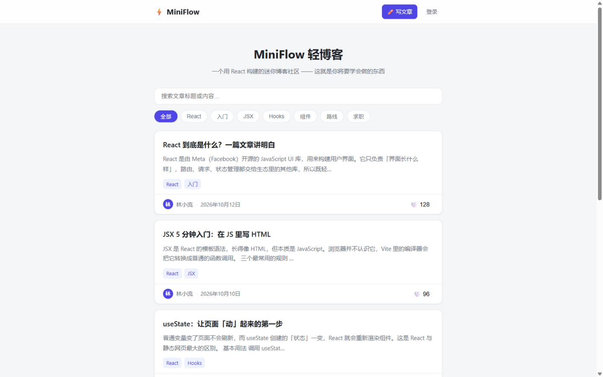
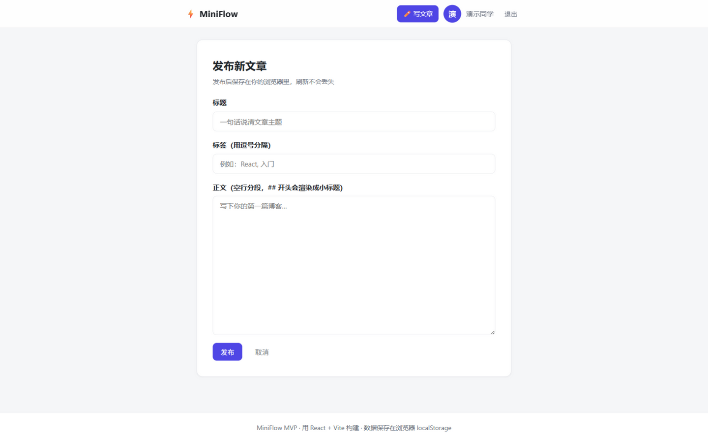

<div align="center">

# ⚡ MiniFlow

**一个用 React 18 构建的迷你博客社区 · React 入门实战项目**

文章列表 / 搜索标签筛选 · 点赞 · 模拟登录 · 写文章 · React Router 路由

[](https://react.dev)
[](https://vitejs.dev)
[](https://reactrouter.com)

</div>

## 🖼️ 界面预览

**文章列表** —— 搜索关键词、标签筛选、点赞数一目了然：



**写文章** —— 登录后进入编辑器，表单校验 + 标签 + Markdown 小标题渲染：



一个用 React 构建的迷你博客社区，也是你的 React 入门实战项目。
当前为 **MVP 版本**：纯前端实现，所有数据保存在浏览器 localStorage，无需后端。

## 功能

- 📃 文章列表：搜索关键词、标签筛选
- 📄 文章详情：小标题渲染、阅读时长估算
- ❤️ 点赞 / 取消点赞（刷新不丢）
- 🔐 模拟登录（昵称即身份，存本地）
- ✍️ 发布文章（表单校验）、删除自己的文章
- 🧭 React Router 路由：首页 / 详情 / 编辑器 / 登录

## 启动

```bash
npm install   # 第一次运行前安装依赖
npm run dev   # 启动开发服务器，默认 http://localhost:5173
npm run build # 打包生产版本到 dist/
```

## 目录结构（对照学习）

```
src/
├── main.jsx              # 入口：挂载 React、路由、全局状态
├── App.jsx               # 页面骨架 + 路由表
├── styles.css            # 全部样式（CSS 变量、卡片、响应式）
├── data/seed.js          # 预置文章假数据（将来换成接口）
├── hooks/
│   └── useLocalStorage.js # 自定义 Hook：状态同步到 localStorage
├── context/
│   └── AppContext.jsx     # 全局状态：文章、用户、点赞（useContext）
├── components/
│   ├── Navbar.jsx         # 导航栏（登录态切换）
│   └── ArticleCard.jsx    # 文章卡片组件
└── pages/
    ├── Home.jsx           # 首页：搜索 + 标签筛选 + 列表
    ├── ArticleDetail.jsx  # 详情页：useParams 取路由参数
    ├── Editor.jsx         # 写文章：受控表单 + 校验 + 路由守卫
    └── Login.jsx          # 模拟登录
```

## 这个项目覆盖的 React 知识点

| 知识点 | 在哪看 |
|---|---|
| 组件与 props | `components/ArticleCard.jsx` |
| useState 状态管理 | `pages/Home.jsx` 的搜索词和标签 |
| useEffect 副作用 | `hooks/useLocalStorage.js` |
| useContext 全局状态 | `context/AppContext.jsx` |
| 自定义 Hook | `hooks/useLocalStorage.js` |
| React Router 路由 / 路由参数 / 守卫 | `App.jsx`、`pages/ArticleDetail.jsx`、`pages/Editor.jsx` |
| 受控表单与校验 | `pages/Editor.jsx`、`pages/Login.jsx` |
| 列表渲染与 key | `pages/Home.jsx` |

## 下一步（进阶方向）

1. 把 seed 数据换成 json-server 真接口（阶段 4）
2. 接入 Zustand 或 Redux Toolkit 管理状态（阶段 5）
3. 迁移 TypeScript、配置 ESLint（阶段 6）
4. 部署到 Vercel，拿到线上链接写进简历
