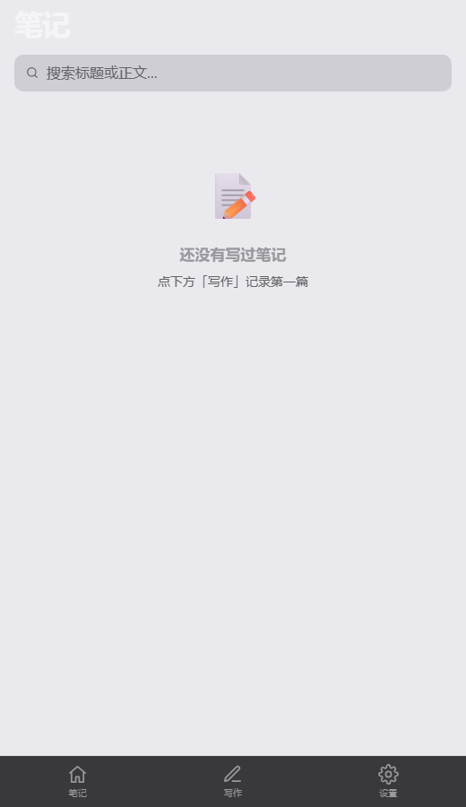
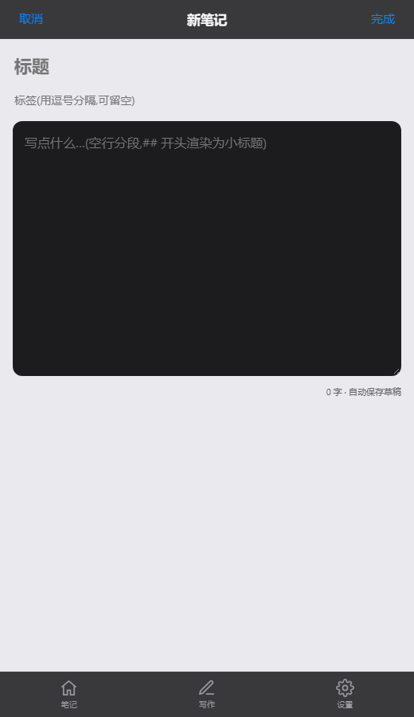

<div align="center">

# ⚡ MiniFlow

**我的私人笔记博客 · Apple 风格 · PWA · 本地加密**

大标题与毛玻璃导航 · 底部标签栏 · 深浅色自适应 · 可安装到主屏幕 · 离线可用 · 口令加密锁 · Markdown 导出

[](https://react.dev)
[](https://vitejs.dev)
[](public/manifest.webmanifest)
[](src/lib/crypto.js)



</div>

## 🎬 使用场景

刚学 React 的你，看完文档还是不知道怎么"做出一个东西"。MiniFlow 就是那句"跟着做一遍就会了"：列表、路由、状态、表单，每一页都对应一个核心概念。

v2.0 起它也是**我自己在用的私人博客**——记录想法、草稿与日常，Apple 风格界面，可像 App 一样安装到手机主屏幕。

## ✨ 特性

- 🎨 **Apple 设计语言** —— iOS 系统色板、毛玻璃导航（`backdrop-filter`）、大标题、分组列表、iOS 风格开关与分段控制、底部标签栏（安全区适配）
- 🌗 **深浅色三档** —— 自动跟随系统 / 手动浅色 / 手动深色，切换平滑过渡；也支持 `?theme=dark` 链接参数直达
- 🔒 **私密锁（可选）** —— 口令经 PBKDF2（15 万次迭代）派生密钥，文章以 **AES-GCM 加密**落盘；localStorage 里只有密文，拿到设备也看不到内容；支持一键锁定/解锁
- 📱 **PWA** —— manifest + Service Worker：可安装到主屏幕全屏运行、断网可打开、资源缓存自动更新
- 💾 **数据自主权** —— 全部数据只在本机浏览器；一键导出 JSON 备份 / 全部 Markdown / 单篇 .md，支持导入合并
- ✍️ **写作体验** —— 自动保存草稿（刷新不丢）、`##` 小标题渲染、标签分段过滤、全文搜索、字数统计
- 🪶 **零依赖后端** —— 纯前端实现，任何静态托管（GitHub Pages / Vercel）直接部署

## 🖼️ 界面预览

| 首页（深色） | 编辑器 |
| --- | --- |
|  |  |

## 🚀 启动

```bash
npm install
npm run dev     # 开发（默认 5173）
npm run build   # 生产构建 → dist/
```

## 📁 结构

```
src/
├── lib/
│   ├── crypto.js        # WebCrypto：PBKDF2 派生 + AES-GCM 加解密
│   └── store.js         # 文章读写 / 私密模式 / 导入导出
├── context/AppContext.jsx  # 全局状态：文章 CRUD / 主题 / 私密锁
├── components/          # TabBar / iOS 风格图标
└── pages/               # Home / ArticleDetail / Editor / Settings / Lock
public/
├── manifest.webmanifest # PWA 清单
├── sw.js                # Service Worker（外壳缓存 + 离线回退）
└── icons/               # 应用图标
```

## ⚠️ 数据安全须知

- 数据**只存在本机浏览器**：清浏览器数据 = 清空笔记，**定期导出 JSON 备份**
- 开启私密锁后**口令不可恢复**（无后端、无重置）：忘记口令 = 无法解密；开启前先导出明文备份
- GitHub Pages 为公开托管：内容经加密后存储，明文不上传

## 🗺️ Roadmap

- [ ] 可选云同步（端到端加密，密钥不出设备）
- [ ] 图片插入与压缩
- [ ] 全文检索升级（拼音首字母匹配）

## 📄 License

[MIT](LICENSE)
